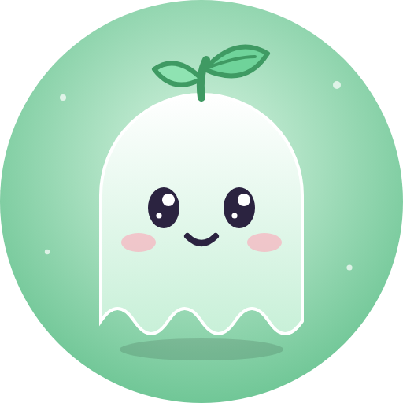
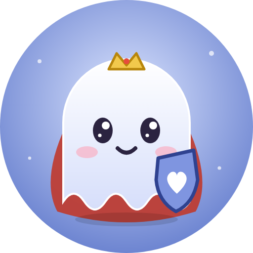
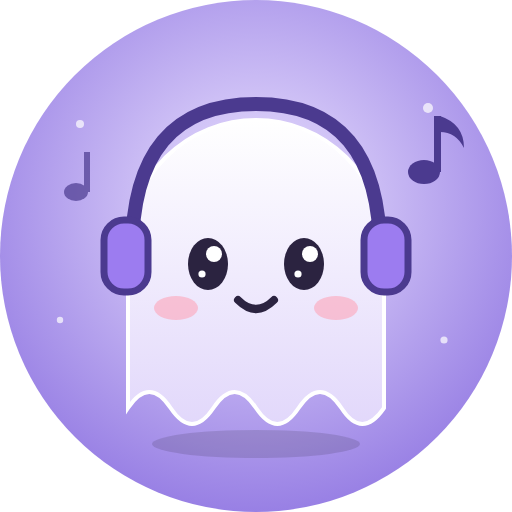
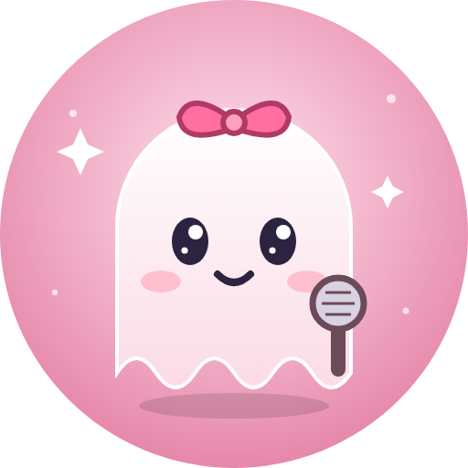
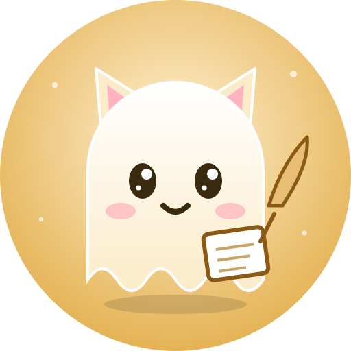

<h1 align="center">👻 Ghost Royale</h1>

<em>Une flotte de petits fantômes IRC qui veillent sur #montreal, #kodi et #paris (Undernet).</em>

<table align="center">
  <tr>
    <td align="center" width="20%"> <a href="https://github.com/pierrealexandredumouchel-creator/jade14"><b>Jade</b></a> L'opératrice énergique <i>chasse au canard, RPG</i></td>
    <td align="center" width="20%"> <a href="https://github.com/pierrealexandredumouchel-creator/christin"><b>Christine</b></a> La gardienne calme <i>désamorce, aide technique</i></td>
    <td align="center" width="20%"> <b>Anya</b> L'habituée chaleureuse <i>jase, suit la discussion</i></td>
    <td align="center" width="20%"> <b>Tanya</b> La commandante tactique <i>modération, sauvegardes</i></td>
    <td align="center" width="20%"> <b>Millie</b> La chatte en chef <i>op, carnet de bord</i></td>
  </tr>
</table>

  
  
  
  

## La flotte

Cinq bots Python, chacune avec sa personnalité, qui jasent en français québécois grâce à une IA locale
(**GhostBrain** sur Ollama, rien ne sort du serveur). Elles suivent la discussion, savent à qui elles parlent
et préfèrent dire « j'invente pas » plutôt que d'halluciner.

- 🌿 **Jade** lance les jeux : chasse au canard et RPG du canal.
- 👑 **Christine** garde le calme et répond aux questions techniques.
- 🎧 **Anya** jase avec la gang et comprend les ordres en mots.
- 🎤 **Tanya** commande la flotte, modère et veille sur les sauvegardes.
- 🐱 **Millie** donne l'op à la flotte et tient le carnet de bord.

Fait à Montréal par alxd 💜

